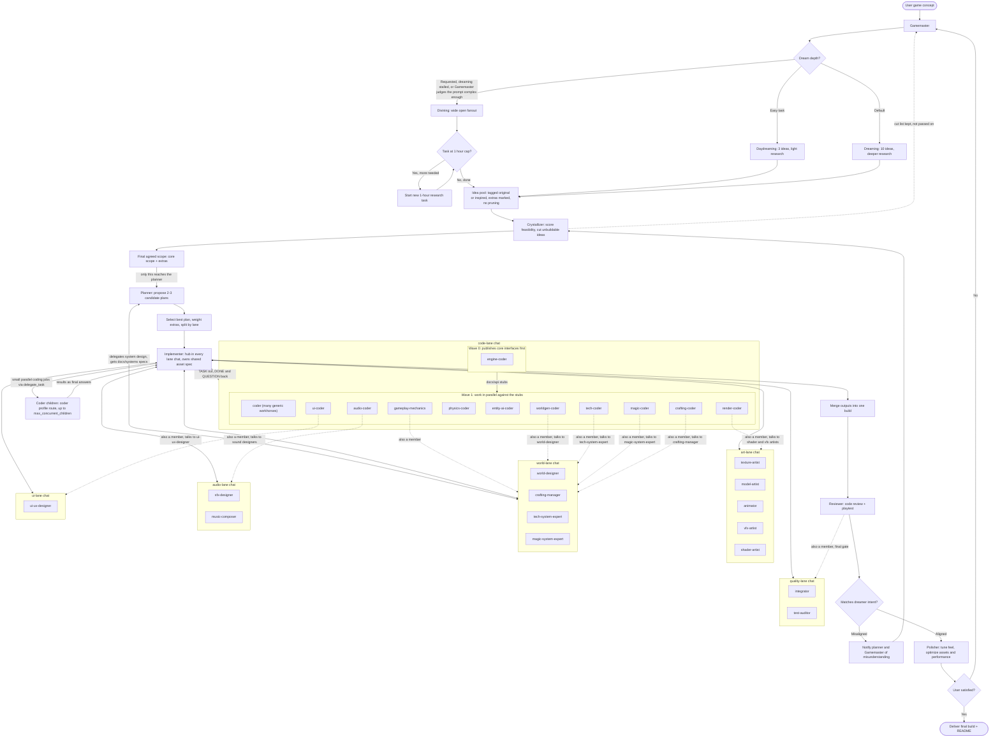

# Gamemaster Team: Flowchart

Render in any Markdown viewer that supports Mermaid (GitHub, Obsidian, VS Code with a Mermaid extension).

Lanes are group chats that their bots share. Tools belong to the bots, not the lanes. Full SOULs, tool lists, and the roster are in `souls/README.md`.

## Main flow

## Notes

- A lane is a group chat. Each bot in a lane is shown as its own node. Bots in a lane talk to each other there; each bot keeps its own tools.
- The Implementer is a member of every lane chat, shown as one edge per lane. The Reviewer also sits in the quality-lane chat.
- The code lane has an engine-coder that publishes core interfaces first (Wave 0). Then the specialist coders and the generic coder workhorses work in parallel against those stubs (Wave 1).
- Specialist coders that implement another lane's spec also sit in that lane's chat (dotted edges), so they can ask the spec's author directly. Interface and asset-spec changes still go through the Implementer.
- Cross-lane questions are posted to the Implementer in the asker's own lane chat. The Implementer relays them and logs the relay.
- The Planner delegates design of the technology system, magic system, crafting, and world generation to the experts in #world-lane. It still reads only the crystallizer's final scope from upstream.
- Integration and Test/Auditor work on outputs routed to them by the Implementer in #quality-lane. The Reviewer stays the single final gate.
- Coder children cannot use chat, memory, or scheduling tools, so they return results as their final answer.
- The only backward path is the misaligned verdict, which restarts at the Crystallizer rather than the Dreamer.
- The Gamemaster reports progress between divining tasks so the user can stop or redirect.
