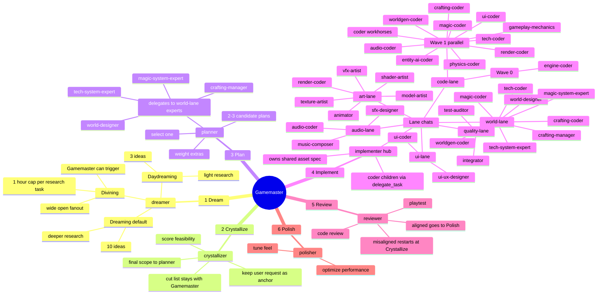

# Gamemaster Team: Hierarchical Mindmap

The Gamemaster runs the lifecycle. Phases run in order. In the implement phase, the implementer is the hub in every lane chat, and each lane is a group chat that its bots share. Tools belong to the bots. Full SOULs and tool lists are in `souls/README.md`. Review is the only path that loops back.

## Text hierarchy

```
Gamemaster (persistent, user's single point of contact, in #phase-room)
│
├── 1. DREAM: dreamer
│   ├── Daydreaming: 3 ideas per deliverable, light research, easy tasks only
│   ├── Dreaming (default): 10 ideas per deliverable, deeper research
│   └── Divining
│       ├── Wide, open-ended fanout (pushes the parallel design space the most)
│       ├── Broad research, capped at 1 hour per research task (successive tasks if more is needed)
│       └── Used on request, when dreaming stalls, or when the Gamemaster judges the prompt complex enough
│   Output: idea pool tagged original/inspired, extras marked, no pruning
│
├── 2. CRYSTALLIZE: crystallizer
│   ├── Score ideas on feasibility, cost, and fit
│   ├── Keep the user's explicit request as the anchor
│   ├── Carry extras forward (weighting left to planner)
│   └── Output: final scope (to planner), cut list (kept by Gamemaster)
│
├── 3. PLAN: planner (reads only the final scope)
│   ├── Propose 2-3 candidate plans, select one
│   ├── Weight each extra (core request stays at full weight)
│   ├── Delegate system design to the #world-lane experts
│   │   ├── tech-system-expert (energy, machines, logistics, tiers)
│   │   ├── magic-system-expert (power source, spells, rituals, progression)
│   │   ├── crafting-manager (recipes, registry, progression gates)
│   │   └── world-designer (terrain, biomes, resources, structures)
│   └── Split tasks by lane
│
├── 4. IMPLEMENT: implementer (hub in every lane chat, owns the shared asset spec)
│   ├── Delegate children: coder profile route, small parallel coding jobs
│   └── Lane group chats (bots talk inside a lane; cross-lane goes through implementer)
│       ├── #code-lane
│       │   ├── Wave 0: engine-coder (publishes core interfaces first)
│       │   └── Wave 1 (parallel): coder workhorses, gameplay-mechanics, render-coder, worldgen-coder, physics-coder, entity-ai-coder, tech-coder, magic-coder, crafting-coder, ui-coder, audio-coder
│       ├── #art-lane: texture-artist, model-artist, animator, vfx-artist, shader-artist, render-coder (also in code-lane)
│       ├── #world-lane: world-designer, crafting-manager, tech-system-expert, magic-system-expert, gameplay-mechanics, worldgen-coder, tech-coder, magic-coder, crafting-coder (coders also in code-lane)
│       ├── #audio-lane: sfx-designer, music-composer, audio-coder (also in code-lane)
│       ├── #ui-lane: ui-ux-designer, ui-coder (also in code-lane)
│       └── #quality-lane: integrator, test-auditor, reviewer
│   Output: merged build
│
├── 5. REVIEW: reviewer
│   ├── Code review (design flaws, overparameterization)
│   ├── Playtest (does it match the dreamer's intent?)
│   └── Verdict
│       ├── aligned ──────► 6. POLISH
│       └── misaligned ───► notify planner and Gamemaster, restart at CRYSTALLIZE
│
└── 6. POLISH: polisher
    ├── Tune feel, timing, feedback
    ├── Optimize assets and performance
    ├── No new features, no scope changes
    └── Output: final build, remaining polish items
        └── Gamemaster repeats the cycle until the user is satisfied
```

## Mermaid mindmap


