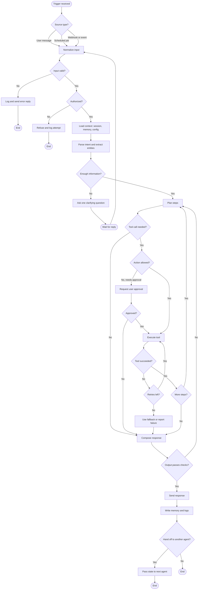
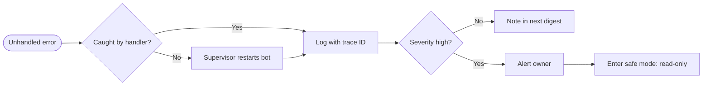

# Bot Process Flowchart

A general process flow for a bot, from trigger to response. Each diamond is a decision point. Render this file in any Markdown viewer that supports Mermaid (GitHub, Obsidian, VS Code with a Mermaid extension, and most wiki tools).

## Main flow

## Error and escalation path

## Process stages

| Stage | Purpose | Typical output |
|---|---|---|
| Intake | Normalize and validate input | Clean request object |
| Authorization | Confirm the sender may ask for this | Allow or deny |
| Context load | Gather session, memory, and config | Working context |
| Intent parse | Decide what the user wants | Task and entities |
| Planning | Break the task into steps | Ordered step list |
| Execution | Run tools with retries and fallbacks | Tool results |
| Quality check | Verify output before sending | Pass or revise |
| Delivery | Send reply and persist state | Reply plus log entry |
| Handoff | Pass work to another bot if needed | Updated shared state |

## Notes

- Every run gets a trace ID so logs from each stage can be joined later.
- Actions that change external state (sending messages, deleting data, spending money) always pass through the approval branch.
- The quality check loops back to planning, so a bad draft gets revised rather than sent.
